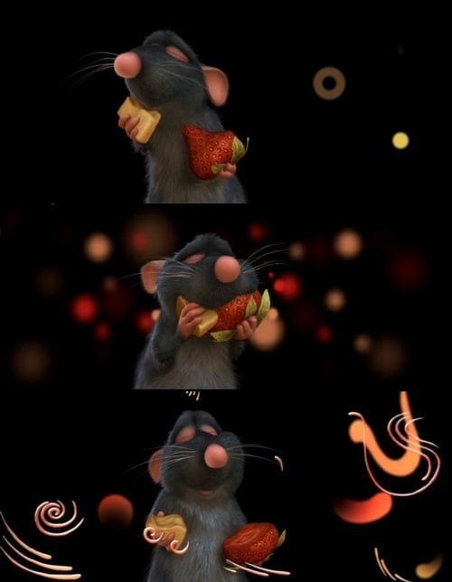
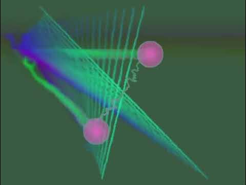
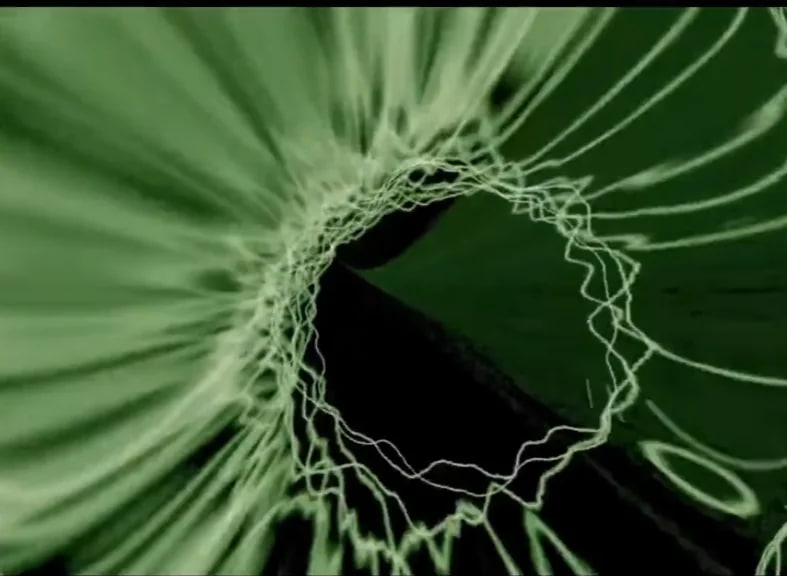

# Audio Auras

Este projeto é um visualizador de áudio interativo em `p5.js`. Como inspiração, usei as antigas visualizações do Windows Media Player e a cena do filme "Ratatui", onde aparecem manchas coloridas desfocadas, auras e linhas onduladas num fundo escuro consoante as sensações.

Queria criar algo parecido com uma rádio/leitor vivo, onde a música muda sempre, não há interface fixa no ecrã e as formas reagem livremente por todo o espaço. Também é possível guardar qualquer frame como imagem (com a tecla `S`), por exemplo para usar depois como gráfico ou textura.

### Etapas e o que foi preciso mudar

1. No início, experimentei fazer círculos simples no centro e depois um triângulo de linhas a voar pelo ecrã. Mas parecia demasiado aborrecido e previsível, por isso desisti dessas ideias — queria que aparecessem formas diferentes por todo o ecrã.
2. Depois comecei a criar grandes auras desfocadas e ondas distorcidas. Primeiro tentei deixar rastos com um fundo preto semitransparente, mas ficavam sempre marcas cinzentas atrás das figuras, por isso mudei para gradientes suaves nas auras e para duplicação das posições nas ondas, de forma a deixarem uma cauda que vai desaparecendo aos poucos. Também reduzi o número de pontos nas linhas para a animação não ficar lenta.
3. Fiz com que o próprio fundo não fosse só preto, mas mudasse suavemente de tons escuros ao ritmo da música. Na primeira tentativa piscava com demasiada força a cada batida, pelo que tive de tornar as transições muito mais suaves.
4. O que deu mais trabalho foi afinar a reação ao som. Quando todas as frequências reagiam ao mesmo tempo, nas partes mais altas ficava tudo confuso no ecrã, e nas partes calmas ou com voz não acontecia nada. Por isso, decidi usar o volume geral como base (que se ajusta automaticamente a músicas calmas ou mais altas) e definir prioridades. Quando há um pico de volume, ganha apenas uma frequência principal: os graves criam uma aura grande, os médios (guitarra, voz, melodia) criam uma onda curva com rasto e os agudos criam pequenas faíscas brilhantes.
5. Para não ficar presa apenas a uma música, liguei o projeto à API pública da Audius — ao abrir ou ao carregar na tecla `N`, carrega uma faixa aleatória (e se não houver internet, toca a música `ophelia.mp3`). Também dá para arrastar um ficheiro de áudio próprio diretamente para a janela do navegador e ele começa logo a tocar, sem guardar nada em lado nenhum. A tecla `S` guarda o frame atual sem o texto da legenda em baixo.

### Controlos

Clique ou `Space` — pausa / reproduzir
`N` — próxima faixa aleatória
Arrastar um ficheiro de áudio para a janela — tocar a própria música
`S` — guardar o frame em PNG

### As fontes

https://p5js.org/reference/
https://p5js.org/reference/p5.sound/
https://api.audius.co/

### Utilização de IA e aprendizagem

Durante o projeto, usei a IA como apoio para perceber melhor como trabalhar com som e frequências em `p5.js`, descobrir porque ficavam rastos cinzentos no fundo, afinar o ajuste automático do volume para estilos de música diferentes e ligar faixas online e ficheiros arrastados para a janela. Fui testando tudo com várias músicas e ajustando a lógica e os valores consoante o que via no ecrã.

### Prompts

*"how can I make glowing blurred auras and distorted waves in p5.js that leave fading trails when moving across the screen"*

*"why does my visualizer turn into a mess during loud parts and ignore vocals, how can I combine volume triggers with frequency priorities"*

*"how to load random songs from a public audio api in p5.js, let the user drop an audio file into the window and save the canvas without overlay text"*
